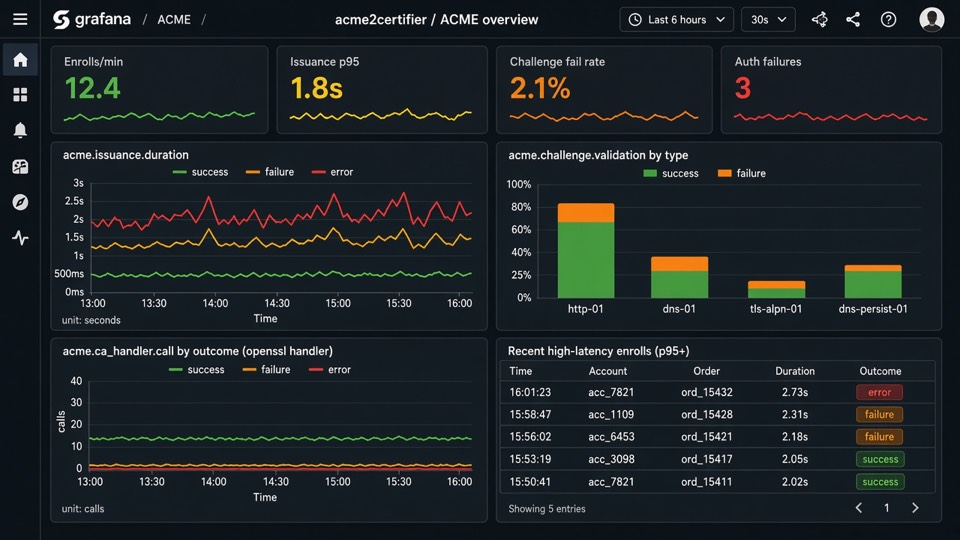
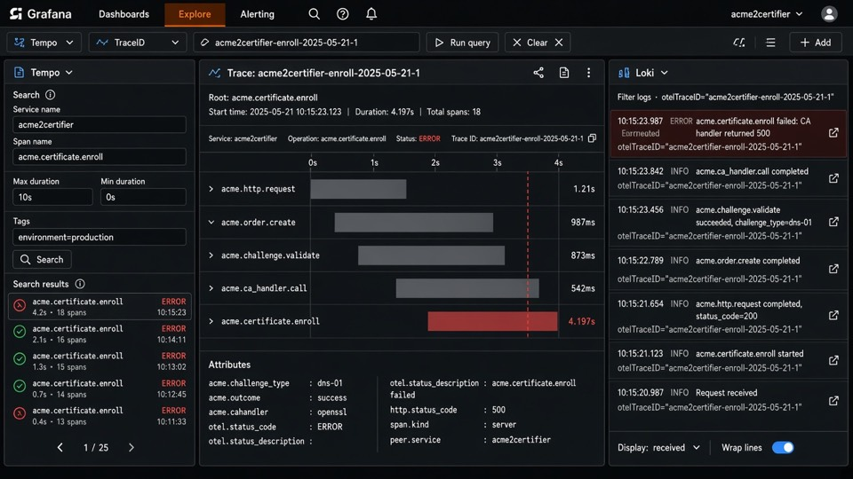

<!-- markdownlint-disable MD013 -->

<!-- wiki-title: OpenTelemetry (experimental) -->
<!-- wiki-category: Configuration -->

# OpenTelemetry support (experimental)

Optional, **config-gated** export of traces and metrics via **OTLP HTTP**. Logging remains the primary ops surface ([Logging](logging.md)); OpenTelemetry is additive.

**Status:** experimental. Span/metric names and config knobs may change. Enabling logs a one-line `WARNING` at ACME HTTP boot.

## Install

Requires **Python ≥ 3.8** (OpenTelemetry SDK). Core acme2certifier without this extra still supports older Pythons.

**Docker (Hub apache2 / nginx images, Ubuntu 26.04):** OTEL libraries are already baked in via apt (`python3-opentelemetry-api`, `python3-opentelemetry-sdk`, `python3-opentelemetry-exporter-otlp-proto-http`). Enable with `[OpenTelemetry]` only — no pip.

**pip / venv:**

```bash
pip install 'acme2certifier[otel]'
```

Use a dedicated/disposable virtualenv for the extra. Distro DEB/RPM packages of acme2certifier do **not** pull OTEL dependencies; on Ubuntu 26.04+ you can install the same `python3-opentelemetry-*` packages from `universe` instead of PyPI.

If `opentelemetry_support` is `True` but packages are missing, boot continues with a NoOp warning and an error is logged.

## Configuration (`[OpenTelemetry]`)

| Option | Description | Values | Default |
| ------ | ----------- | ------ | ------- |
| `opentelemetry_support` | Master switch | True/False | False |
| `endpoint` | OTLP HTTP base URL (traces use `/v1/traces`, metrics `/v1/metrics` when enabled) | URL | `http://127.0.0.1:4318` |
| `protocol` | Export protocol (v1: HTTP/protobuf only) | `http/protobuf` | `http/protobuf` |
| `service_name` | OTEL resource `service.name` | string | `acme2certifier` |
| `sample_ratio` | Trace sampling ratio in \[0.0, 1.0\] | float | `1.0` |
| `metrics_export` | Export OTLP metrics to `{endpoint}/v1/metrics`. Leave `False` for Jaeger-only (many all-in-one builds have no metrics endpoint → periodic 404s). | True/False | False |
| `db_span_methods` | JSON list of DBstore method names that emit `acme.db.<name>` spans. Default is write/mutate only (no lookups/nonce/jwk). `[]` disables DB spans. Invalid JSON → default. | JSON list | write/mutate allowlist |

### Example

```ini
[OpenTelemetry]
opentelemetry_support: True
endpoint: http://127.0.0.1:4318
protocol: http/protobuf
service_name: acme2certifier
sample_ratio: 1.0
metrics_export: False
# optional; omit for the default write/mutate allowlist, or use [] to disable
# db_span_methods: ["order_add", "order_update", "account_lookup"]
```

Restart acme2certifier after changing the file. Init runs from the shared ACME HTTP boot path (`acme_http_boot`), used by classic WSGI and Django ACME views.

## What is instrumented (v1)

| Spans | Metrics |
| ----- | ------- |
| `acme.http.request` (root per HTTP request; Django middleware / classic WSGI) | |
| `acme.nonce.check` / `acme.nonce.issue` | |
| `acme.jws.verify` | `acme.auth.failure` (counter; jws / eab) |
| `acme.account.create` | |
| `acme.account.query` (`onlyreturnexisting` / POST empty payload) | |
| `acme.account.deactivate` / `contact_update` / `key_change` | |
| `acme.order.create` | |
| `acme.authorization.create` | |
| `acme.challenge.create` | |
| `acme.challenge.validate` | `acme.challenge.validation` (counter; type + outcome) |
| `acme.certificate.enroll` (`acme.cahandler` once the CA is resolved) | `acme.issuance.duration` (histogram; outcome + cahandler when known) |
| `acme.ca_handler.call` (enroll / revoke) | `acme.ca_handler.call` (counter; handler + operation + outcome) |
| `acme.db.<operation>` (light DBstore API; allowlist via `db_span_methods`, default writes only) | |

**Limits (experimental):** Tip/nonce state is **in-process only** (not shared across workers). The **global** tip is last-writer-wins for anonymous GETs on one worker (two clients hitting `/`/`directory` concurrently can interleave). After requests carry an account `kid`, each account keeps its **own** tip so authenticated hops stay separated. Challenge validation and certificate enrollment run in `ThreadWithReturnValue` so child spans keep the enrollment-session context.

Common attributes (when available): `http.method`, `http.route`, `http.status_code`, `acme.challenge_type`, `acme.identifier_type`, `acme.cahandler`, `acme.ca_operation`, `acme.order_name`, `acme.account_name`, `acme.outcome`, `db.operation`, `db.system` (DBstore `type`, e.g. `wsgi` / `django`).

**Span status (Jaeger error flag):** OTEL `StatusCode.ERROR` is set only for server-side failures — `acme.outcome=error` (exceptions / unexpected internal failures) and HTTP `5xx` on `acme.http.request`. ACME protocol rejects stay `acme.outcome=failure` (or `skipped`) without ERROR status.

**Log ↔ trace:** `logger_setup` / `init_otel` attach a filter (on loggers **and handlers**) that sets `otelTraceID` and `otelSpanID` on LogRecords. Include them in `[Helper] log_format` (see [Logging](logging.md)). Values are zeros when OTEL is off or no span is active. Handler attachment matters so OTEL SDK / other child loggers that propagate to root do not break formatting.

## Grafana (optional)

There is Lab stack (Docker): [`examples/Docker/grafana/compose.yaml`](../examples/Docker/grafana/compose.yaml) running `grafana/otel-lgtm` as part of the CI. If you want to try yourself:

- create an external network `ot-test`
- start the stack by `docker compose up -d`
- point a2c `endpoint` at `http://otel-lgtm:4318` with `metrics_export: True`,
- open Grafana on port 3000 (`admin` / `admin`).

With `metrics_export: True` and OTLP → Prometheus/Mimir (plus Tempo/Loki for drill-down), import the sample dashboard:

[`examples/grafana/acme2certifier-overview.json`](../examples/grafana/acme2certifier-overview.json)

Grafana → Dashboards → Import → upload the JSON → pick the Prometheus datasource. Metric names assume the usual OTLP→Prometheus translation (`acme.issuance.duration` → `acme_issuance_duration_*`). Adjust label names if your collector differs. TraceQL/LogQL snippets for Explore are in the bottom panel of that dashboard.

Illustrative mocks (sample data, not a live deploy):





## Related

- Config table: [acme_srv.md](acme_srv.md) (`OpenTelemetry` section)
- Logging (primary): [logging.md](logging.md)
